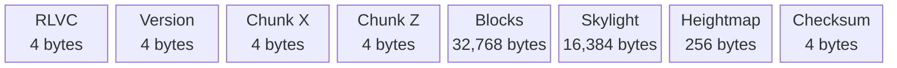

# World saves

Create or open worlds from the main menu. Choose a name, seed, and Creative or
Survival mode. Leave the seed empty for a random one. Renaming a world does not
rename its folder.

Worlds are stored in `saves/` under the working directory. Use `--saves-dir` to
choose another folder.

Archiving moves a world into `.trash/` inside the saves folder. To restore it,
move its folder back out of `.trash/`.

## Files

```text
world-<creation-time>-<number>/
  world.meta
  chunks/
    <chunk-x>_<chunk-z>.bin
```

`world.meta` stores world and player settings. Chunk files store terrain.
Both formats are version 1. Graphics settings and network state are not saved.

## world.meta

Example `world.meta`:

```text
RLVOXEL_WORLD 1
My World
seed: 12345
saved: 1700000000
time: 6000
player: 1 0.5 74 0.5 0 0
mode: 1 0 2 3
```

`saved` is a Unix timestamp and `time` is the world clock in ticks.
`player` contains the saved-player flag, X/Y/Z, yaw, and pitch.
`mode` contains the mode (0 = Creative, 1 = Survival), flight flag, zero-based
hotbar slot, and block ID. Floats use nine significant digits to preserve precision.

## Chunk byte layout

Each chunk file is 49,428 bytes. Fields run left to right, with no padding.
Box widths are not to scale. Version, coordinates, and checksum are little-endian.
X and Z are signed 32-bit coordinates. The checksum is FNV-1a.



The loader checks each file before using it. Missing chunks are generated from
the seed. Damaged files or unknown versions fail to load and are not regenerated.
Lighting is recalculated on load.

## Saving

The server saves chunks before unloading them and saves all loaded chunks and
player data every 60 seconds of simulation time. Leaving through the pause menu
or closing the window also saves. In multiplayer, the remote server handles this.

If saving a chunk fails, it stays loaded. If a pause-menu save fails, the game
stays open and shows an error so you can retry. A failed save on window close
prints an error to stderr and exits with a nonzero status.

Writes use a `.tmp` file, flush it (`fsync` on Unix), then rename it over the old
file. Failed writes leave the old file intact. Files are replaced one at a time.
So concurrent access from different version of the engine may cause issues.

Autosaves block the server thread while writing. The local server thread is
stopped and joined before the final save.
Do not open the same world in two sessions at once.

## Open a world directly

```bash
./build/rlVoxel --world saves/<world-folder>
./build/rlVoxelServer --world saves/<world-folder>
```
